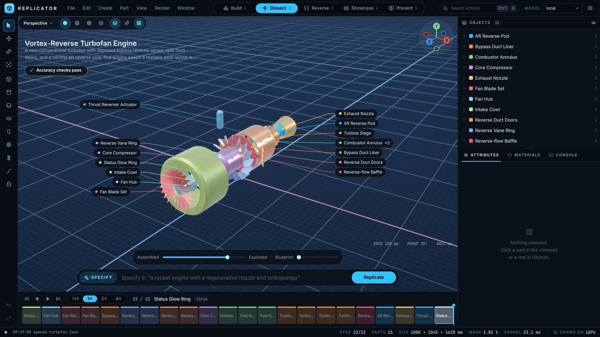
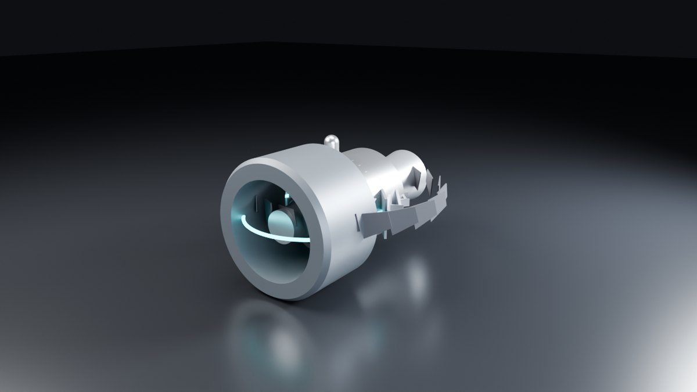

<p align="center"></p>

<p align="center">
  
  
  
  
  
</p>

<p align="center">
  <a href="#quick-start">Quick start</a> &nbsp;·&nbsp; <a href="#how-it-works">How it works</a> &nbsp;·&nbsp; <a href="#the-buildprogram">BuildProgram</a> &nbsp;·&nbsp; <a href="#modes">Modes</a> &nbsp;·&nbsp; <a href="#image-to-3d">Image to 3D</a> &nbsp;·&nbsp; <a href="#blender">Blender</a> &nbsp;·&nbsp; <a href="#roadmap">Roadmap</a>
</p>

# Replicator

You dream it, you build it. Describe an object in a sentence. A local model plans it and writes a
build program, and the object assembles on a 3D workshop floor one step at a time. You can stop it
at any step and change it.

Replicator is the Holodeck's sibling: the Holodeck dreams the image and the Replicator builds the
object. Everything runs on your machine. The model runs on llama-swap, the geometry comes from
manifold3d, and the workshop window draws on the integrated GPU. Nothing goes to a cloud service.

```sh
./launch.sh                                   # an empty workshop
./launch.sh fixtures/dirk_engine_v2.json      # open a program and watch it build
./launch.sh ~/Downloads/robot.glb             # take a mesh apart in Reverse
```

## How it works

<p align="center"></p>

1. **Dream.** You type what you want: *"a turbofan with reverse thrust doors"*.
2. **Blueprint.** Dirk-27B plans the object first: its parts, their sizes in millimetres, the
   materials and how the parts fit together. The plan comes before any geometry, so the model never
   has to invent coordinates on the fly.
3. **BuildProgram.** A second pass turns the blueprint into an ordered list of operations
   (`revolve`, `array`, `boolean`, `loft` and the rest), each tagged with the component it builds.
   The program is plain JSON, validated against a schema generated from the kernel's own op table.
   When an op fails, the errors go back to the model and it repairs the program.
4. **Kernel.** manifold3d evaluates the program. Each op's result is cached by a hash of its inputs,
   so a rebuild after an edit redoes only what changed. A full build takes 10 to 60 ms.
5. **Workshop.** The steps play on the floor. Each new part comes in through a holo shader: a
   wireframe edge pass, a rising scan plane, then a dissolve into the real material.

Build step *k* is ops 0 to *k*. An op that a later op consumes disappears at that step, so every
step shows the object as it stood at that moment, like the construction history in a CAD package.

Edits work the same way. Type *"make the reverser doors wider"* and the model answers with a JSON
Patch against the program, not a new program. Each save is a version you can step back to.

## What Replicator does

**Builds from a sentence**
- **Two-stage dreaming.** A blueprint pass plans the object, then a program pass writes the ops. The
  prompts carry the rules that make engineered shapes look right: hollow bodies get a real wall,
  radial rings follow the body axis, and every op carries a label and a component.
- **Repairs itself.** Validation and kernel errors go back to the model with the failing op, for up
  to two repair rounds. The parser strips the comments, trailing commas and code fences local
  models tend to add.
- **Edits by patch.** An edit is a JSON Patch: applied, validated, then saved as a version. A bad
  patch never replaces a good program.
- **Your choice of local model.** `dirk` (Dirk-27B, the default, reasoning at xhigh), the `coder` and
  `agent` roles on llama-swap, or `strata` when that engine is up.

**A real modelling kernel**
- **manifold3d.** Watertight solids, exact booleans and convex hulls. A program can't produce a mesh
  with holes in it.
- **19 operations.** Primitives (`box`, `cylinder`, `sphere`, `torus`, `capsule`, `extrude`,
  `revolve`), builders (`loft`, `pipe`, `helix`, `gear` with involute teeth), modifiers
  (`transform`, `array` linear/radial/mirror, `smooth`, `round`, `shell`, `deform` taper/twist/bend),
  combiners (`boolean`, `hull`, `group`) and `mesh` for imported geometry.
- **Exports.** GLB with materials for engines and the web, STL for the printer.

**A Cinema 4D-style workspace**
- **Viewport.** A damped orbit camera with zoom to cursor and adaptive clip planes, a perspective
  view and three orthographic ones (`F1` to `F4`), an axis triad, and a move gizmo with snapping
  (`W`). `H` frames everything, `F` frames the selection.
- **Managers.** An Object Manager grouped by component, an Attribute Manager for the selected op's
  parameters and placement, and a console.
- **Timeline.** Every op is a block. Play forward or in reverse, scrub, or jump to any step (`Space`
  plays and pauses).
- **Blueprint morph.** One slider fades the scene from a cyan-on-navy technical drawing to full PBR.

## Modes

| Key | Mode | What it is for |
|---|---|---|
| `1` | **Build** | Watch the build, pick any step, change its parameters or placement, rebuild. |
| `2` | **Dissect** | An exploded view: every part slides out along its own axis, and callouts with leader lines follow the parts. |
| `3` | **Reverse** | Import a mesh (`Ctrl+I`: GLB, glTF, OBJ, STL, PLY, OFF) and take it apart into pieces, repeated patterns, contacts and a likely assembly order. Every finding sits in an evidence ledger marked *observed*, *inferred* or *unknown*, and *Name parts* asks the model to label the pieces. |
| `4` | **Showcase** | A product stage with soft shadows, ambient occlusion, depth of field and a turntable. *Render* writes a Cycles still on the CPU in about 7 s. |

## Preview

<p align="center"></p>

<p align="center"></p>

<p align="center"></p>

<p align="center"></p>

## Quick start

Replicator is built for one workstation (Arch Linux, Hyprland, an Intel iGPU beside an RTX card)
and runs on any Linux machine with Qt 6.12.

```sh
git clone git@github.com:T-Crypt/replicator.git && cd replicator
python -m venv .venv --system-site-packages        # PySide6 6.12 comes from the system pyside6 package
.venv/bin/pip install manifold3d trimesh numpy scipy networkx pillow jsonpatch cascadio pycollada
.venv/bin/python -m pytest -q tests                # kernel, schema and reverse tests
./launch.sh fixtures/vector_engine.json
```

Dreaming needs an OpenAI-compatible endpoint. The defaults point at llama-swap on
`127.0.0.1:9090`; edit `ENGINES` in [`replicator/llm/client.py`](replicator/llm/client.py) to use
your own. The Showcase render and the Blender round trip need `blender` 5.x on `PATH`.

### Headless frames

Qt's `offscreen` platform can't run Qt Quick 3D, so `--shot` loads the window hidden and grabs a frame:

```sh
.venv/bin/python -m replicator.app fixtures/dirk_engine_v2.json --software --shot out/build.png
.venv/bin/python -m replicator.app fixtures/dirk_engine_v2.json --software --shot out/x.png --mode dissect --explode 0.9
```

`--step N`, `--blueprint 0..1`, `--select ID` and `--size WxH` set up the frame. The README previews
come from these commands.

## The BuildProgram

Every view edits one JSON document. Ops run in order; placement (`translate`, `rotate`, `scale`)
applies last. Coordinates are Y-up and right-handed, in the program's `units`.

```json
{
  "version": 1, "name": "Vector engine", "units": "mm",
  "materials": {"steel": {"base_color": [0.6, 0.62, 0.65], "metalness": 1.0, "roughness": 0.35}},
  "ops": [
    {"id": "nacelle", "op": "revolve", "label": "Nacelle", "component": "Intake Cowl",
     "params": {"points": [[60, 0], [64, 0], [62, 180], [58, 180]]}, "material": "steel"},
    {"id": "blade", "op": "box", "label": "Fan blade", "component": "Fan Blade Set",
     "params": {"size": [4, 40, 14]}, "translate": [0, 30, 20]},
    {"id": "fan", "op": "array", "input": "blade", "label": "Fan, 18 blades", "component": "Fan Blade Set",
     "params": {"mode": "radial", "count": 18, "axis": "z"}}
  ]
}
```

A saved program lives in a `<name>.replicator/` folder: `program.json` plus `history/NNNN.json`, one
file per version, so an edit can be undone across sessions.

## Image to 3D

Some shapes don't come from a list of operations: characters, creatures, anything organic. For
those, Replicator turns a picture into a mesh locally and opens it in Reverse. This lane is being
built; see the [roadmap](#roadmap).

## Blender

Render > *Open in Blender* sends the current build to Blender 5.x through a vendored copy of the
[mcp-for-blender](vendor/mcp-for-blender) add-on (pinned, update check off, telemetry off, listening
on `localhost:9876` only). Sculpt or texture it there, then *Pull back from Blender* brings the
result into Reverse. The same server can be driven from an agent harness as an MCP tool.

## Project layout

```
replicator/
  core/program.py       BuildProgram schema, validation, JSON Patch, versions
  core/evaluate.py      manifold3d evaluator with per-op cache and step views
  core/ops_advanced.py  loft, pipe, helix, gear, deform
  core/assembly.py      components and exploded-view axes
  core/reverse.py       mesh analysis and the evidence ledger
  core/render.py        Cycles stills through blender --background
  core/blender_link.py  the mcp-for-blender round trip
  llm/                  dream, repair, edit and name-parts prompts; local engines only
  qt/                   QML bridge, mesh geometry, procedural studio HDRI
  gpu.py                pins the window to the integrated GPU
qml/  shaders/          the workspace, the materialize and blueprint shaders
fixtures/               sample programs, including two Dirk dreams
tools/readme_art.py     draws the README artwork
```

## Roadmap

- [x] M1: text to blueprint to program, step-by-step build, edit by sentence
- [x] Dissect, Reverse and Showcase modes; Blender round trip
- [ ] M3: image to 3D (TRELLIS.2 or Hunyuan3D under a Berth lease), then a Holodeck character sheet straight into the workshop
- [ ] Blueprint sheets: a technical drawing with callouts and dimensions from the program
- [ ] M2: a floor plan becomes rooms (a Sims-style build mode)
- [ ] M4: sculpting and a node editor

## What Replicator never does

- **Never calls a cloud model.** Every dream, repair, edit and label comes from a model on your machine.
- **Never draws on the RTX card.** The window pins itself to the iGPU and quits if it lands on the
  discrete card, which belongs to the models.
- **Never loads a GPU model without a lease.** Image to 3D asks Berth for the card first, so it
  waits for a chat to finish instead of crashing it.
- **Never replaces your program behind your back.** An edit that fails validation is dropped, and
  the last good version stays on screen.
